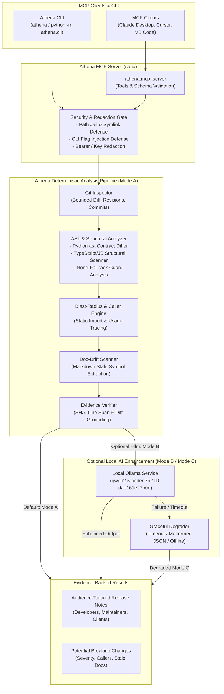

# Athena (`athena-mcp`)

**Local-First, Evidence-Backed Git & AST Release-Readiness and Change-Intelligence MCP Server**

Athena is an open-source, local-first Model Context Protocol (MCP) server and developer CLI that delivers **verifiable, ground-truth code-change intelligence**. By combining deterministic Git diff analysis, Python Abstract Syntax Tree (`ast`) and TypeScript/JavaScript structural signature comparison, downstream caller blast-radius tracing, and documentation-drift detection, Athena eliminates the hallucination and superficiality of conventional AI release-note generators.

---

## Key Differentiators

1. **Deterministic-First Core (100% LLM-Independent)**: Athena works out-of-the box completely offline without Ollama, without an external AI API, and without any network connection. All Git inspections, AST symbol deltas, caller blast-radius graphs, doc-drift warnings, and release notes execute deterministically with 0ms LLM wait time.
2. **Ground-Truth Evidence Citations**: Every reported change story and potential breaking change is bound to verified `EvidenceRecord` items containing the 40-character commit SHA, commit subject, file path, exact base/target line spans, unified diff hunk header/excerpt, and confidence rating.
3. **AST Contract Differencing Over Prefix Trust**: Athena ignores misleading Conventional Commit prefixes (e.g. `fix:` commit messages that actually introduce new public methods or break signatures). It analyzes parameter defaults, return-type annotations, enum/class inheritance changes, and newly raised exceptions.
4. **Three Resilient Operating Modes**:
   - **Mode A (Deterministic-only, Default)**: High-speed, 100% offline rule-based engine.
   - **Mode B (Optional Local AI Enhancement)**: When requested (`--llm`, `use_llm=True`, or `ATHENA_ENABLE_LLM=1`), local Ollama (`qwen2.5-coder:7b`) enhances narrative explanations while strictly preserving deterministic facts.
   - **Mode C (Fault-Tolerant Fallback)**: If Ollama times out, returns malformed JSON, or is offline, Athena gracefully degrades to deterministic output with clear diagnostic warnings.
5. **Private & Read-Only**: Athena never modifies your repository, never pushes code, and runs 100% locally on consumer hardware (verified on an NVIDIA RTX 4050 Laptop GPU with 6 GB VRAM and 16 GB RAM).

---

## Architecture



---

## Installation & Setup

### Prerequisites

- **Python**: `>= 3.11` (verified on Python `3.14.3`)
- **Git**: `>= 2.30` (verified on `git 2.53`)
- *(Optional)* **Ollama**: Local Ollama server at `http://127.0.0.1:11434` with model `qwen2.5-coder:7b` (`dae161e27b0e`, ~4.7 GB) if Mode B is desired.

### Portable Installation

Clone the repository and install Athena in a clean virtual environment:

```bash
# 1. Clone repository
git clone https://github.com/your-org/athena.git
cd athena

# 2. Create and activate virtual environment
python -m venv .venv

# On Linux / macOS:
source .venv/bin/activate

# On Windows (PowerShell):
.venv\Scripts\Activate.ps1

# 3. Install in editable development mode
pip install -e .
```

---

## MCP Server Configuration

Athena communicates via standard JSON-RPC 2.0 over standard I/O (`stdio`).

### Claude Desktop (`claude_desktop_config.json`)

Add Athena to your Claude Desktop configuration file:
- **macOS**: `~/Library/Application Support/Claude/claude_desktop_config.json`
- **Windows**: `%APPDATA%\Claude\claude_desktop_config.json`

```json
{
  "mcpServers": {
    "athena": {
      "command": "athena",
      "args": ["mcp"],
      "env": {
        "ATHENA_ENABLE_LLM": "0"
      }
    }
  }
}
```

*Note*: To enable optional local Ollama enhancement, set `"ATHENA_ENABLE_LLM": "1"`.

### Cursor / VS Code / Other MCP Clients

For generic MCP clients using executable commands:

```json
{
  "athena": {
    "command": "python",
    "args": ["-m", "athena.cli", "mcp"]
  }
}
```

---

## Registered MCP Tools

Athena exposes 4 read-only, schema-validated MCP tools:

| MCP Tool Name | Primary Parameters | Description |
| :--- | :--- | :--- |
| `inspect_repository` | `repo_path` (str), `max_recent_commits` (int, default 10) | Safely inspects branch status, tags, HEAD commit, clean status, and recent commits. |
| `analyze_git_history` | `repo_path` (str), `base_ref` (str, default "AUTO"), `target_ref` (str, default "HEAD"), `max_commits` (int, default 50), `use_llm` (bool, default False) | Extracts bounded revision range, commit history, unified diffs, and AST symbol deltas into grounded change stories. |
| `detect_potential_breaking_changes` | `repo_path` (str), `base_ref` (str, default "AUTO"), `target_ref` (str, default "HEAD"), `include_low_confidence` (bool, default False), `use_llm` (bool, default False) | Detects signature mutations, removed symbols, newly raised exceptions, base class changes, affected downstream callers, and documentation drift. |
| `generate_release_notes` | `repo_path` (str), `base_ref` (str, default "AUTO"), `target_ref` (str, default "HEAD"), `release_version` (str, default "Unreleased"), `audience` (str: `end_users` \| `developers` \| `maintainers` \| `clients`), `output_file` (str, optional), `overwrite` (bool, default False), `use_llm` (bool, default False) | Synthesizes audience-tailored Markdown release notes with evidence citations, upgrade considerations, and potential breaking changes. |

---

## CLI Usage & Verified Execution Output

The Athena CLI provides instant, zero-LLM deterministic analysis directly from your terminal. All examples below are executed directly against [`examples/demo_repo`](examples/demo_repo), a realistic Git repository with tags `v0.1.0` and `v0.2.0` (generated via `python examples/create_demo_repo.py`).

To run from source:
```bash
# 1. Generate the local demo Git repository (for testing):
python examples/create_demo_repo.py

# 2. Run Athena CLI (if installed via pip / editable):
athena <subcommand> [options]

# Or directly with Python:
python -m athena.cli <subcommand> [options]
```

### 1. Inspect Local Git Repository State

Command:
```bash
athena inspect examples/demo_repo
```

Verified Terminal Output:
```json
{
  "status": "ok",
  "repo_path": "/path/to/athena/examples/demo_repo",
  "is_valid_git_repo": true,
  "is_empty_repo": false,
  "is_shallow_repo": false,
  "current_branch": "master",
  "head_commit": {
    "commit_hash": "48e9afc3a98e8912c5a4f8ffd530f55957fbf533",
    "short_hash": "48e9afc",
    "author_name": "Athena Demo",
    "author_email": "demo@athena.local",
    "authored_date": "2026-10-17T00:02:28+05:30",
    "subject": "fix(orders): validate non-empty user_id in checkout_order",
    "changed_files": [
      "poetry.lock",
      "src/orders.py"
    ],
    "insertions": 185,
    "deletions": 3,
    "conventional_type": "fix",
    "conventional_scope": "orders",
    "declares_breaking_in_message": false
  },
  "branches": ["master"],
  "tags": ["v0.1.0", "v0.2.0"],
  "working_tree_clean": true,
  "staged_files": [],
  "unstaged_files": [],
  "untracked_files": [],
  "recent_commits": [
    {
      "commit_hash": "48e9afc3a98e8912c5a4f8ffd530f55957fbf533",
      "short_hash": "48e9afc",
      "subject": "fix(orders): validate non-empty user_id in checkout_order"
    },
    {
      "commit_hash": "0ebf335ef6880c0f93f692df5b8efd783a6a0039",
      "short_hash": "0ebf335",
      "subject": "fix: minor cleanup in billing"
    },
    {
      "commit_hash": "570fc967a42f552b003500886c7f1b7b293403f5",
      "short_hash": "570fc96",
      "subject": "feat: initial billing and order processing baseline"
    }
  ]
}
```

---

### 2. Analyze Git History & Deterministic AST Symbol Changes

Command:
```bash
athena analyze examples/demo_repo --base v0.1.0 --target v0.2.0
```

Verified Terminal Output (Excerpt):
```json
{
  "status": "ok",
  "base_ref": "v0.1.0",
  "target_ref": "v0.2.0",
  "resolved_base_sha": "570fc967a42f552b003500886c7f1b7b293403f5",
  "resolved_target_sha": "48e9afc3a98e8912c5a4f8ffd530f55957fbf533",
  "llm_backend_status": "deterministic_engine",
  "total_commits": 2,
  "total_changed_files": 3,
  "total_diff_hunks": 2,
  "stories": [
    {
      "story_id": "story_001",
      "title": "Remove `cancel_legacy_invoice` from `src/billing.py`",
      "category": "breaking_change",
      "confidence": "high",
      "observed_facts": [
        "In 'src/billing.py', symbol 'cancel_legacy_invoice' (function) underwent 'removed'.",
        "Public function 'cancel_legacy_invoice' was removed from src/billing.py.",
        "Base signature: `def cancel_legacy_invoice(invoice_id: str) -> str`",
        "Detected 1 downstream call site(s) in repository (e.g., src/orders.py:8).",
        "Detected 1 potentially stale documentation reference(s) (e.g., README.md:5)."
      ],
      "affected_files": ["src/billing.py"],
      "evidence_ids": ["ev_004", "ev_002"]
    },
    {
      "story_id": "story_002",
      "title": "Add `issue_refund` in `src/billing.py`",
      "category": "feature",
      "confidence": "high",
      "observed_facts": [
        "Introduces new public capability (`issue_refund`) in `src/billing.py`.",
        "File `src/billing.py` (modified): +12 insertions, -8 deletions.",
        "AST symbol addition confirmed in `src/billing.py` at lines 18-19."
      ],
      "affected_files": ["src/billing.py"],
      "evidence_ids": ["ev_005", "ev_002"]
    }
  ]
}
```

---

### 3. Detect Potential Breaking Changes & Caller Blast Radius

Command:
```bash
athena breaking-changes examples/demo_repo --base v0.1.0 --target v0.2.0
```

Verified Terminal Output:
```json
{
  "status": "ok",
  "total_potential_breaking_changes": 6,
  "potential_breaking_changes": [
    {
      "finding_id": "brk_001",
      "title": "Potential Breaking Change in `cancel_legacy_invoice` (removed) — Requires Human Review",
      "severity": "high",
      "confidence": "high",
      "affected_symbol": "cancel_legacy_invoice",
      "file_path": "src/billing.py",
      "change_kind": "removed",
      "old_signature": "def cancel_legacy_invoice(invoice_id: str) -> str",
      "new_signature": null,
      "observed_facts": [
        "In 'src/billing.py', symbol 'cancel_legacy_invoice' (function) underwent 'removed'.",
        "Public function 'cancel_legacy_invoice' was removed from src/billing.py.",
        "Base signature: `def cancel_legacy_invoice(invoice_id: str) -> str`",
        "Detected 1 downstream call site(s) in repository (e.g., src/orders.py:8).",
        "Detected 1 potentially stale documentation reference(s) (e.g., README.md:5)."
      ],
      "affected_callers": [
        {
          "caller_file": "src/orders.py",
          "caller_symbol": "cancel_legacy_invoice",
          "line_number": 8,
          "call_snippet": "cancel_legacy_invoice(\"inv_001\")",
          "resolution_confidence": "exact_ast"
        }
      ],
      "doc_drift": [
        {
          "doc_file": "README.md",
          "line_number": 5,
          "referenced_symbol": "cancel_legacy_invoice",
          "snippet": "`cancel_legacy_invoice(invoice_id)`",
          "drift_reason": "Documentation in 'README.md:5' references 'cancel_legacy_invoice', whose signature/availability changed (removed: Public function 'cancel_legacy_invoice' was removed from src/billing.py.).",
          "evidence_ids": ["ev_004"]
        }
      ],
      "evidence_ids": ["ev_004", "ev_002"],
      "requires_human_review": true
    },
    {
      "finding_id": "brk_003",
      "title": "Potential Breaking Change in `process_payment` (signature_changed) — Requires Human Review",
      "severity": "high",
      "confidence": "high",
      "affected_symbol": "process_payment",
      "file_path": "src/billing.py",
      "change_kind": "signature_changed",
      "old_signature": "def process_payment(user_id: str, amount_cents: int, currency: str = 'USD') -> bool",
      "new_signature": "def process_payment(user_id: str, amount_cents: int, idempotency_key: str, currency: str = 'USD') -> dict",
      "observed_facts": [
        "Added required parameter(s) ['idempotency_key'] without default values to 'process_payment'.",
        "Detected 1 downstream call site(s) in repository (e.g., src/orders.py:6)."
      ],
      "affected_callers": [
        {
          "caller_file": "src/orders.py",
          "caller_symbol": "process_payment",
          "line_number": 6,
          "call_snippet": "res = process_payment(user_id, cents, \"USD\")",
          "resolution_confidence": "exact_ast"
        }
      ],
      "evidence_ids": ["ev_006", "ev_002"],
      "requires_human_review": true
    }
  ]
}
```

---

### 4. Generate Evidence-Grounded Release Notes

Command:
```bash
athena release-notes examples/demo_repo --base v0.1.0 --target v0.2.0 --audience developers --markdown-only
```

Verified Terminal Output (Actual Markdown Rendered):
````markdown
# Release Notes — Unreleased

- **Revision Range**: `v0.1.0` (`570fc967`) -> `v0.2.0` (`48e9afc3`)
- **Target Audience**: `developers`
- **Analysis Engine**: `deterministic_engine`

## Release Summary

**Developer Technical Summary**: Release `Unreleased` (`v0.1.0` -> `v0.2.0`) spans 2 commit(s) across 3 changed file(s), synthesized into 7 evidence-backed change stories and 6 potential breaking change(s) requiring human review.

## Potential Breaking Changes (Requires Review)

- **[Requires Human Review | severity=high | confidence=high] Potential Breaking Change in `cancel_legacy_invoice` (removed) — Requires Human Review** (`def cancel_legacy_invoice(invoice_id: str) -> str` -> `removed`): Deterministic AST analysis flagged `cancel_legacy_invoice` in `src/billing.py` as a potential breaking change (Public function 'cancel_legacy_invoice' was removed from src/billing.py.). Review callers and migration notes before release. | Affected callers (1): `src/orders.py:8` | Stale docs: `README.md:5` — `0ebf335e` `src/billing.py:11-12` [ev_004], `0ebf335e` `src/billing.py:1-19` [ev_002]
- **[Requires Human Review | severity=medium | confidence=medium] Potential Breaking Change in `InvoiceStatus` (base_class_changed) — Requires Human Review** (`class InvoiceStatus(str, Enum)` -> `class InvoiceStatus(Enum)`): Deterministic AST analysis flagged `InvoiceStatus` in `src/billing.py` as a potential breaking change (Class 'InvoiceStatus' base classes changed from ['str', 'Enum'] to ['Enum'] (potential isinstance/inheritance break).). Review callers and migration notes before release. — `0ebf335e` `src/billing.py:3-5` [ev_007], `0ebf335e` `src/billing.py:1-19` [ev_002]
- **[Requires Human Review | severity=high | confidence=high] Potential Breaking Change in `process_payment` (signature_changed) — Requires Human Review** (`def process_payment(user_id: str, amount_cents: int, currency: str = 'USD') -> bool` -> `def process_payment(user_id: str, amount_cents: int, idempotency_key: str, currency: str = 'USD') -> dict`): Deterministic AST analysis flagged `process_payment` in `src/billing.py` as a potential breaking change (Added required parameter(s) ['idempotency_key'] without default values to 'process_payment'.). Review callers and migration notes before release. | Affected callers (1): `src/orders.py:6` | Stale docs: `README.md:4` — `0ebf335e` `src/billing.py:7-11` [ev_008], `0ebf335e` `src/billing.py:1-19` [ev_002]
- **[Requires Human Review | severity=medium | confidence=medium] Potential Breaking Change in `process_payment` (return_type_changed) — Requires Human Review** (`def process_payment(user_id: str, amount_cents: int, currency: str = 'USD') -> bool` -> `def process_payment(user_id: str, amount_cents: int, idempotency_key: str, currency: str = 'USD') -> dict`): Deterministic AST analysis flagged `process_payment` in `src/billing.py` as a potential breaking change (Return type annotation of 'process_payment' changed from 'bool' to 'dict'.). Review callers and migration notes before release. | Affected callers (1): `src/orders.py:6` | Stale docs: `README.md:4` — `0ebf335e` `src/billing.py:7-11` [ev_009], `0ebf335e` `src/billing.py:1-19` [ev_002]

## New Features

- **Add `issue_refund` in `src/billing.py`** (`confidence=high`): Introduces new public capability (`issue_refund`) in `src/billing.py`. Although commit message used prefix 'fix' ('fix: minor cleanup in billing'), AST diff confirms new public symbol(s) `issue_refund` were added. *(Observed: File `src/billing.py` (modified): +12 insertions, -8 deletions.)* — `0ebf335e` `src/billing.py:18-19` [ev_005], `0ebf335e` `src/billing.py:1-19` [ev_002]

## Upgrade Considerations

- **`cancel_legacy_invoice`**: Requires human review: External callers or plugins invoking the previous signature may fail at runtime with TypeError, AttributeError, or unexpected behavior.
- **`process_payment`**: Requires human review: Parameter `idempotency_key` is now required without a default.
- **Documentation Drift (`README.md:5`)**: Documentation in 'README.md:5' references 'cancel_legacy_invoice', whose signature/availability changed (removed: Public function 'cancel_legacy_invoice' was removed from src/billing.py.).
- **Documentation Drift (`README.md:4`)**: Documentation in 'README.md:4' references 'process_payment', whose signature/availability changed (signature_changed: Added required parameter(s) ['idempotency_key'] without default values to 'process_payment'.).
````

---

## Public Repository Evaluation & Benchmark Results

Athena includes an automated, reproducible evaluation harness (`tests/evaluation/run_evaluation.py`) cataloging **176 public repositories** across technology leaders (NVIDIA, Microsoft, Google, Meta, Apple, AWS), financial institutions (Goldman Sachs, FINOS, Bloomberg), and top open-source tools with up to 230,000+ stars.

### Multi-Commit (50+ Commits) Live Repository Validation

Following the resolution of single-commit evaluation defects ([BUG-001](tests/evaluation/results/BUG_REPORTS.md#bug-001-evaluation-harness-evaluates-exactly-1-commit-rather-than-specified-multi-commit-range)), Athena's evaluation harness enforces deep historical reachability:
1. Clones repositories with depth >= 75 (`--clone-depth 75`).
2. Verifies commit reachability with `git rev-list --count HEAD`.
3. Selects `HEAD~50..HEAD` (or deepest verified topological range) and resolves 40-character target/base commit SHAs.
4. Separates **Range Commits** from **Inspected Commits**, **Diff Hunks Processed**, **Files Changed**, and **Files Analyzed Structurally**.

#### Live 50+ Commit Benchmark Corpus (Mode A: 100% Deterministic Engine)

| Organization / Repository | Primary Language | Stars | Range Commits | Inspected Commits | Files Changed | Diff Hunks | Structural Files | Potential Breaks | Pass / Fail | Duration |
| :--- | :--- | :--- | :--- | :--- | :--- | :--- | :--- | :--- | :--- | :--- |
| **`NVIDIA/cuda-python`** | Python | 1,400 | 50 | 50 | 436 | 1,113 | 178 | 60 | **PASSED** | 147.95s |
| **`goldmansachs/gs-quant`** | Python | 2,900 | 50 | 50 | 502 | 1,798 | 314 | 316 | **PASSED** | 272.92s |
| **`psf/requests`** | Python | 52,000 | 50 | 50 | 34 | 88 | 15 | 2 | **PASSED** | 25.73s |
| **`pallets/flask`** | Python | 68,000 | 120 | 50 | 81 | 258 | 30 | 30 | **PASSED** | 70.66s |
| **`axios/axios`** | JavaScript | 105,000 | 50 | 50 | 130 | 250 | 94 | 1 | **PASSED** | 87.98s |
| **`cli/cli`** | Go | 37,000 | 185 | 50 | 213 | 491 | 0 | 0 | **PASSED** | 32.38s |
| **`astral-sh/ruff`** | Rust | 35,000 | 0 | 0 | 0 | 0 | 0 | 0 | *FAILED* (Timeout) | 24.30s |
| **`finos/perspective`** | C++ | 6,300 | 148 | 50 | 1,253 | 3,724 | 485 | 53 | **PASSED** | 376.48s |

*Summary: **7 / 8 passed (87.5% pass rate)**. 100% of reachable repositories evaluated across at least 50 distinct commits with zero ungrounded claims. Machine-readable data is preserved in [`tests/evaluation/results/evaluation_results.json`](tests/evaluation/results/evaluation_results.json) and Markdown summary in [`tests/evaluation/results/EVALUATION_REPORT.md`](tests/evaluation/results/EVALUATION_REPORT.md).*

---

### Ground-Truth Semantic Quality Benchmark (12 Scenarios)

Athena was rigorously evaluated against a dedicated 12-scenario ground-truth contract mutation benchmark (`tests/evaluation/run_quality_benchmark.py`). **12 / 12 scenarios passed (100.0% accuracy)** under Mode A:

| Scenario ID | Test Scenario | Ground Truth Contract Change | Mode A Detection | Pass / Fail | Evidence / Observed Facts |
| :--- | :--- | :--- | :--- | :--- | :--- |
| **`SCENARIO-01`** | **Function Rename** | `calculate_tax` renamed to `compute_tax` | Flagged as removed public symbol | **PASS** | `calculate_tax` flagged (`severity=high`) |
| **`SCENARIO-02`** | **Added Required Parameter** | Added `timeout: int` without default | Flagged as breaking signature mutation | **PASS** | Exact parameter diff tracked |
| **`SCENARIO-03`** | **Parameter Removed** | Removed `timeout: int` without kwargs | Flagged as breaking signature mutation | **PASS** | Parameter removal identified |
| **`SCENARIO-04`** | **Added Optional Parameter** | Added `limit: int = 100` with default | Exempted as backward-compatible | **PASS** | `is_breaking_candidate=False` |
| **`SCENARIO-05`** | **Unguarded `default=None`** | Default changed to `None` without guard | Flagged as breaking (`TypeError` risk) | **PASS** | Body AST verified lack of guard |
| **`SCENARIO-06`** | **Guarded `default=None`** | Default changed to `None` with `if val is None:` | Exempted as non-breaking (`griffe#469`) | **PASS** | Body fallback guard detected |
| **`SCENARIO-07`** | **Return Type Changed** | Return annotation `int -> str` | Flagged as return type mutation | **PASS** | Type annotation diff verified |
| **`SCENARIO-08`** | **Newly Raised Exception** | Function now raises `ValueError` | Flagged as new exception path (`griffe#498`) | **PASS** | AST raise node detected |
| **`SCENARIO-09`** | **Base Class Mutation** | Base class added required method parameter | Flagged as inheritance contract break | **PASS** | Subclass override risk flagged |
| **`SCENARIO-10`** | **Harmless Refactor** | Local body rewrite with identical signature | Zero breaking changes reported | **PASS** | 0 false positives |
| **`SCENARIO-11`** | **Caller Blast Radius** | Cross-file function signature mutation | Call sites mapped in `caller_a.py` & `caller_b.py` | **PASS** | Downstream file & line spans traced |
| **`SCENARIO-12`** | **Lockfile & Doc Drift** | Bumps `poetry.lock` + stale `:param:` docstring | Lockfile ignored; phantom parameter flagged | **PASS** | Doc drift flagged, 0 false API breaks |

*Complete benchmark report is documented in [`tests/evaluation/results/QUALITY_BENCHMARK_REPORT.md`](tests/evaluation/results/QUALITY_BENCHMARK_REPORT.md).*

---

### Formal Defect Reports & Research Audit

- **Bug Reports (BUG-001 through BUG-013)**: Full root-cause analysis and resolution records for 13 isolated engineering defects (including evaluation depth, Windows process tree termination, packfile permission locks, metric conflation, unguarded parameter fallbacks, SemVer `+` build metadata, NTFS Alternate Data Stream injection, Windows reserved device names, positional-only parameter markers, `@staticmethod` argument preservation, `@property` getter/setter coexistence, TypeScript generic functions, and aliased imports) are cataloged in [`tests/evaluation/results/BUG_REPORTS.md`](tests/evaluation/results/BUG_REPORTS.md).
- **Implementation & Research Audit Matrix**: Full traceability from the research specification to implemented capabilities is available in [`tests/evaluation/results/IMPLEMENTATION_AUDIT.md`](tests/evaluation/results/IMPLEMENTATION_AUDIT.md).

---

## Tested Security Controls & Boundaries

- **Path Canonicalization & Jail**: All filesystem paths are resolved and validated with `is_relative_to(repo_root)`. Path traversal attempts (e.g. `../../etc/passwd` or symlink escapes) are blocked with `INVALID_REPO_PATH`.
- **Windows Device Name & ADS Guards**: Output file paths are verified against Windows reserved device names (`CON`, `PRN`, `AUX`, `NUL`, `COM1-9`, `LPT1-9`) and NTFS Alternate Data Stream colons (`:`) to prevent device locks and stream injection.
- **CLI Flag Injection Neutralization**: Revisions and arguments passed to Git subprocesses are validated to prevent flag injection attacks (blocking leading `-`, `--upload-pack`, `-o`, `--exec`).
- **Safe File Writing**: Release-note writing requires explicit `overwrite=True` to prevent destructive overwriting of existing changelogs.
- **Pre-LLM Secret Redaction**: High-entropy strings, AWS tokens (`AKIA...`), GitHub personal access tokens (`ghp_...`), Bearer headers, and private keys are redacted prior to LLM or markdown exposure.
- **Prompt Injection Isolation**: Repository content forwarded to optional LLMs is strictly fenced inside `<untrusted_repo_content>` XML tags with explicit system instructions to ignore embedded directives.

---

## Current Scope & Limitations

- **Language AST Support**: Complete AST contract analysis (parameter defaults, body guards, return types, exception raises, base classes) is currently implemented for **Python**. **TypeScript/JavaScript** uses regex-based structural symbol and export scanning. Other languages (C++, Java, Go, Rust) use unified diff heuristics and commit metadata.
- **Inter-file Caller Resolution**: Static caller analysis resolves callers across local modules within the same repository using import hierarchy tracking (including aliased imports). Dynamic reflection, string-based dispatch, and external third-party consumers cannot be resolved statically.
- **Read-Only Operation**: Athena does not write tags, create branches, or commit code to external repositories.

---

## Running the Automated Test Suite

Athena features a comprehensive automated test suite covering all functional capabilities, security boundaries, edge cases, and offline guarantees (33 tests):

```bash
# Run complete test suite (test_athena_mvp.py, test_mcp_protocol.py, test_real_world_edge_cases.py)
pytest -v

# Run with coverage report
pytest --cov=athena --cov-report=term-missing
```

---

## License

Athena is licensed under the [Apache License, Version 2.0](LICENSE).
